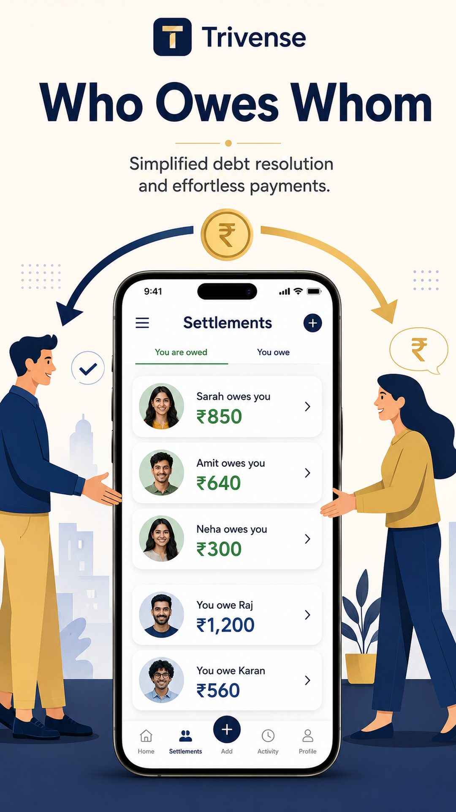

# Trivense

**Split expenses, made easy.**

Trivense is an expense tracker for trips, households, and groups. Create boards, log spending, invite people with a share code, and see who owes whom — built for India, with INR-first pricing.

[](https://trivense.vercel.app)
[](https://play.google.com/store/apps/details?id=com.trivense.app)

<p align="center">
  
</p>

<p align="center">
  
  
  
  
</p>

---

## Live

| | |
|---|---|
| **Website** | [trivense.vercel.app](https://trivense.vercel.app) |
| **Android** | [Google Play — `com.trivense.app`](https://play.google.com/store/apps/details?id=com.trivense.app) |
| **Privacy / terms / ads** | [Privacy](https://trivense.vercel.app/privacy) · [Terms](https://trivense.vercel.app/terms) · [Ads](https://trivense.vercel.app/ads) |
| **Support** | [support@trivense.app](mailto:support@trivense.app) |

iOS is not in the store yet. The website waitlist captures launch updates.

---

## What you can do

- **Expense boards** for a trip, household, or project — each with its own budget and members
- **Split & share** with a code or invite link (`trivense://join/{code}` and `https://trivense.vercel.app/join/{code}`)
- **Settle up** so everyone sees who paid and who owes
- **Analytics** by week, month, year, and all-time
- **Budget alerts** before a board overspends
- **INR + multi-currency** formatting
- **Realtime sync** on Supabase with row-level security
- **English + Hindi** in the app

### Plans

| Plan | Price (India) | Includes |
|------|----------------|----------|
| **Free** | ₹0 | Unlimited personal boards, 1 shared board, settlements, analytics, 3 custom categories, ads |
| **Premium** | ₹299 / month | Ad-free, unlimited sharing, unlimited categories, CSV/JSON export, Google Drive backup |
| **Yearly** | ₹2,499 / year | Everything in Premium, billed annually |

Premium markets (US, UK, EU, and others) bill at local store rates in the app.

---

## Repository

```
Trivense/
├── src/           # Expo / React Native app
├── website/       # Next.js marketing site (live on Vercel)
├── supabase/      # Schema, migrations, waitlist, webhooks
├── e2e/maestro/   # Device QA flows
├── store-assets/  # Play Store listing copy and screenshots
└── ios/           # Native iOS project
```

**App stack:** Expo 54 · React Native 0.81 · React Navigation · Supabase · RevenueCat · AdMob · Sentry

**Website stack:** Next.js 16 · Tailwind CSS · Supabase waitlist

---

## Run locally

### Mobile app

```bash
cp .env.example .env
npm install
npm start
```

Then `npm run ios` or `npm run android`. Copy keys from `.env.example` (Supabase, RevenueCat, AdMob).

### Website

```bash
cd website
cp .env.example .env.local
npm install
npm run dev
```

Open [http://localhost:3000](http://localhost:3000).

---

## Tests

```bash
npm test              # Jest
npm run test:ui      # UI module tests
npm run qa:preflight  # Env / native import checks
```

---

## License

Private product source for [Bhagirihi](https://github.com/Bhagirihi). Contact [support@trivense.app](mailto:support@trivense.app).
